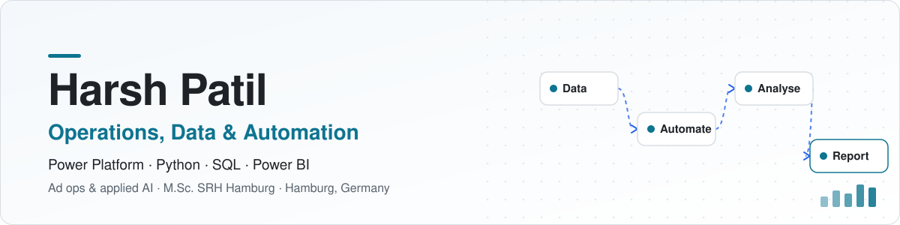

<picture>
  <source media="(prefers-color-scheme: dark)" srcset="assets/banner-dark.svg">
  
</picture>

  <a href="https://www.linkedin.com/in/harshpatil05/">LinkedIn</a> &nbsp;·&nbsp;
  <a href="mailto:harshpatil05@gmail.com">Email</a> &nbsp;·&nbsp;
  Hamburg, Germany

## Profile

I work at the intersection of business operations, data and automation, in two areas: **digital advertising operations**, where I built Power Platform automations for campaign operations at RTL AdAlliance, and **supply chain and operations analytics**, the focus of my M.Sc. in Supply Chain Management.

## Experience

**Working Student, Digital Demand Operations** · RTL AdAlliance, Hamburg · Mar 2025 – Apr 2026 
Built Power Platform automations for campaign operations.

**Data Science Intern** · Ai Variant · Jul 2024 – Jan 2025 
Machine learning and analytics projects with Python and Streamlit.

## Education

**M.Sc. Supply Chain Management** · SRH University of Applied Sciences Hamburg · 2026 
Thesis: *AI-Driven Automation in Digital Advertising Operations*

**B.E. Electronics and Telecommunication Engineering** · St. Francis Institute of Technology, Mumbai · 2016–2020

## Selected projects

| Project | Summary | Context |
|---|---|---|
| [Optimal Inventory Control](https://github.com/harshpatil01/Inventory-Optimization-LP) | Linear programming model for inventory decisions (Python) | M.Sc. coursework, SRH |
| [Customer Personality Analysis](https://github.com/harshpatil01/Customer_Personality_Analysis) | Customer segmentation with clustering for targeted marketing; Streamlit app | Internship, Ai Variant |
| [Sentiment Analysis of Customer Reviews](https://github.com/harshpatil01/Sentiment-Analysis-Project) | NLP on 568k Amazon reviews, six models compared; Streamlit app | Internship, Ai Variant |
| [Insurance Premium Analysis](https://github.com/harshpatil01/Insurance_Premium_Analysis) | Regression models to predict medical costs; interactive dashboard | Internship, Ai Variant |
| [Smart ATS](https://github.com/harshpatil01/Smart-ATS) | Resume vs. job description checker using an LLM (OpenAI API, Streamlit) | Personal project |

Earlier work: C and embedded systems training projects ([Emertxe-Assignments](https://github.com/harshpatil01/Emertxe-Assignments)) and ExcelR data science coursework ([ExcelR assignments](https://github.com/harshpatil01/Excel-R-Machine-Learning-and-Artificial-Intelligence)).

## Skills

| Area | Tools |
|---|---|
| Workflow automation | Power Automate, Power Apps, SharePoint, Microsoft 365 |
| Data and reporting | Python (pandas), SQL, Power BI, Excel |
| Machine learning | scikit-learn, XGBoost, Streamlit |
| Enterprise systems | SAP S/4HANA |

## Certifications

- [Data Science](https://drive.google.com/file/d/1qGCsNKqiDRNugJUCoTfimetVJMeJttZT/view?usp=share_link), ExcelR (2024)
- [Emertxe Certified Embedded Professional (ECEP)](https://certificate.emertxe.com/?id=21014_020), Emertxe
- [Goethe-Zertifikat A1](https://drive.google.com/file/d/1Xk4YYolx0B8unx3Uw_bQ41TWLdQw9u_n/view), Goethe-Institut
