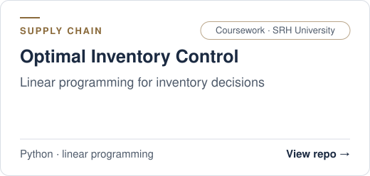
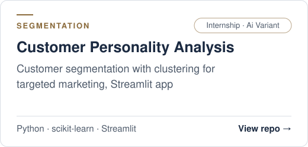
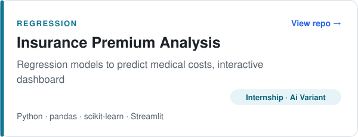
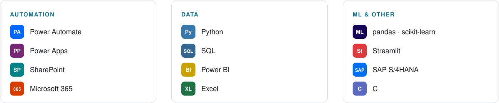

<picture>
  <source media="(prefers-color-scheme: dark)" srcset="assets/banner-dark.svg">
  
</picture>

  <a href="https://www.linkedin.com/in/harshpatil05/">LinkedIn</a> ·
  <a href="mailto:harshpatil05@gmail.com">Email</a> ·
  Hamburg, Germany

## About me

I work at the intersection of **business operations, data and automation**, across two areas:

- **Digital advertising operations.** At RTL AdAlliance I built Power Platform automations for campaign operations.
- **Supply chain and operations analytics.** My M.Sc. in Supply Chain Management covered this, including optimisation models such as inventory planning with linear programming.

**Background**

- **M.Sc. Supply Chain Management**, SRH University of Applied Sciences Hamburg (2026). Thesis: *AI-Driven Automation in Digital Advertising Operations*
- **Working Student, Digital Demand Operations**, RTL AdAlliance, Hamburg (Mar 2025 – Apr 2026): built Power Platform automations for campaign operations
- **Data Science Intern**, Ai Variant (Jul 2024 – Jan 2025): machine learning and analytics projects with Python and Streamlit

## What I build

| Workflow automation | Data analysis & dashboards | Applied machine learning | Supply chain analytics |
|---|---|---|---|
| Power Automate, Power Apps, SharePoint and Python scripts that remove manual steps | Python, SQL and Power BI, from raw data to a clear answer | Classification, segmentation and NLP, evaluated honestly | Optimisation and KPI analysis in Python, from my M.Sc. coursework |

## Featured projects

<a href="https://github.com/harshpatil01/Inventory-Optimization-LP"><picture>
  <source media="(prefers-color-scheme: dark)" srcset="assets/card-inventory-lp-dark.svg">
  
</picture></a>
<a href="https://github.com/harshpatil01/Customer_Personality_Analysis"><picture>
  <source media="(prefers-color-scheme: dark)" srcset="assets/card-customer-personality-dark.svg">
  
</picture></a>

<a href="https://github.com/harshpatil01/Sentiment-Analysis-Project"><picture>
  <source media="(prefers-color-scheme: dark)" srcset="assets/card-sentiment-dark.svg">
  
</picture></a>
<a href="https://github.com/harshpatil01/Insurance_Premium_Analysis"><picture>
  <source media="(prefers-color-scheme: dark)" srcset="assets/card-insurance-dark.svg">
  
</picture></a>

<a href="https://github.com/harshpatil01/Smart-ATS"><picture>
  <source media="(prefers-color-scheme: dark)" srcset="assets/card-smart-ats-dark.svg">
  
</picture></a>

Earlier work: C and embedded systems projects from my Emertxe training ([Emertxe-Assignments](https://github.com/harshpatil01/Emertxe-Assignments)) and ExcelR data science coursework ([ExcelR assignments](https://github.com/harshpatil01/Excel-R-Machine-Learning-and-Artificial-Intelligence)).

## Tools

<picture>
  <source media="(prefers-color-scheme: dark)" srcset="assets/stack-dark.svg">
  
</picture>

## Certifications

- [Data Science](https://drive.google.com/file/d/1qGCsNKqiDRNugJUCoTfimetVJMeJttZT/view?usp=share_link), ExcelR (2024)
- [Emertxe Certified Embedded Professional (ECEP)](https://certificate.emertxe.com/?id=21014_020), Emertxe
- [Goethe-Zertifikat A1](https://drive.google.com/file/d/1Xk4YYolx0B8unx3Uw_bQ41TWLdQw9u_n/view), Goethe-Institut

## Contact

[LinkedIn](https://www.linkedin.com/in/harshpatil05/) · [Email](mailto:harshpatil05@gmail.com)

Banner, cards and tool graphics are plain SVGs generated by [`scripts/build_assets.py`](scripts/build_assets.py).
